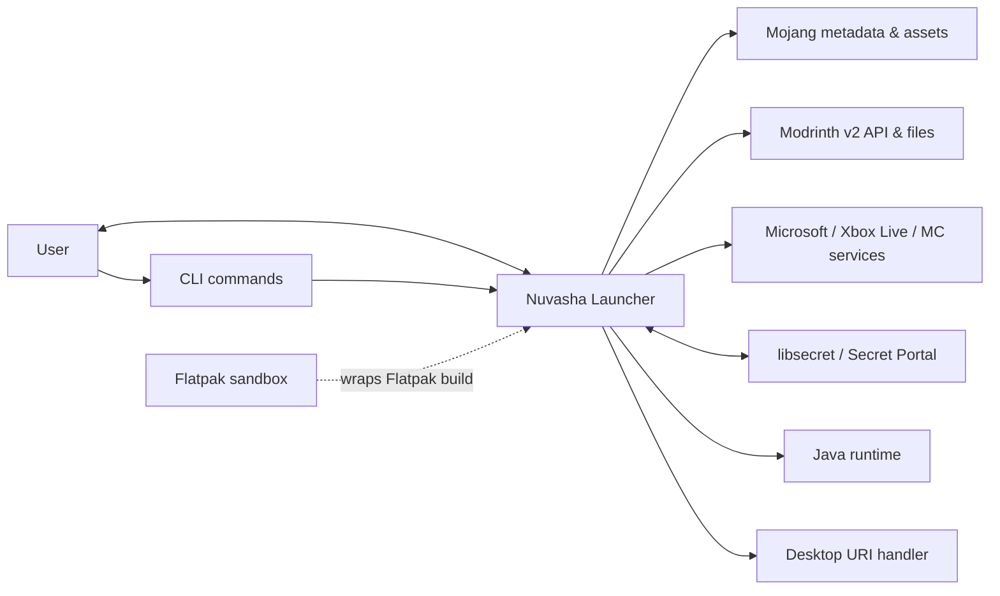
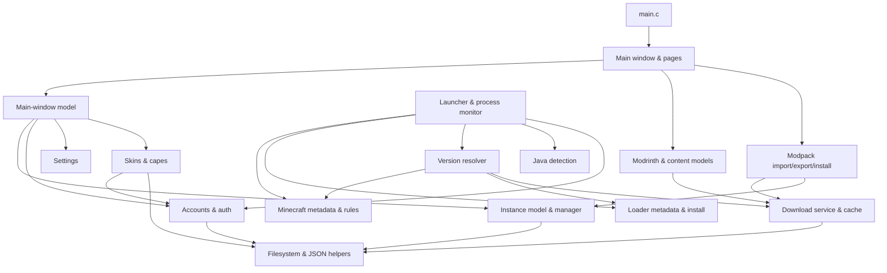
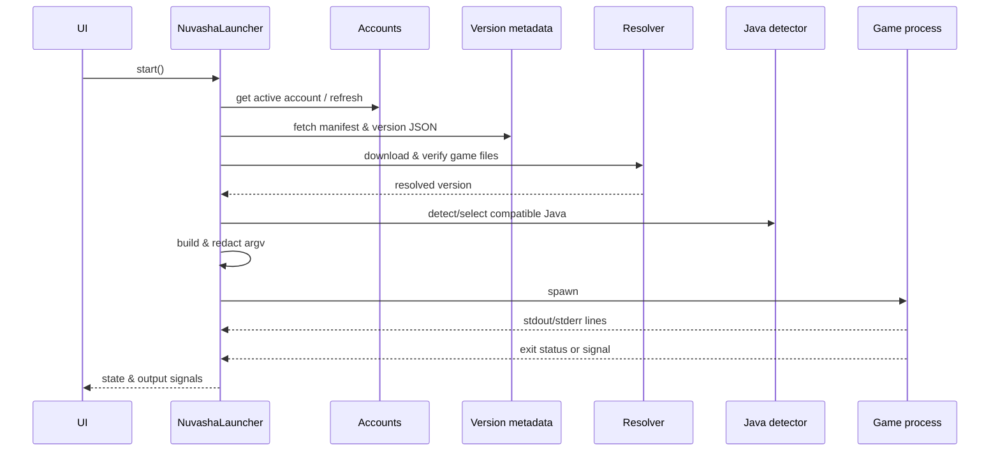

# Architecture

This document covers Nuvasha Launcher's module boundaries, data flows, persistence layout, and security invariants. Public headers in `src/` serve as the API reference.

## Overview

Nuvasha Launcher is a single-binary GTK 4 / libadwaita desktop application for Linux. It manages Minecraft instances, downloads Minecraft and Modrinth content, selects a compatible Java runtime, and spawns one game process per instance—without a background daemon.

Long-running network, filesystem, and subprocess operations expose GIO-style async APIs that return results on the thread-default main context (normally the GTK main loop). UI widgets trigger operations and react to signals, while models, managers, and launchers own the underlying state and transfers.

## System Context

External integrations live in dedicated modules:

- **Mojang metadata:** `nuvashalauncher-minecraft-versions.c` parses the version manifest and version JSONs; `nuvashalauncher-download.c` fetches artifacts.
- **Modrinth API:** `nuvashalauncher-modrinth.c` and `nuvashalauncher-modrinth-requests.c` handle search, projects, versions, and hash lookups.
- **Microsoft auth:** `nuvashalauncher-auth-microsoft.c` implements device-code login, Xbox Live / XSTS exchange, Minecraft auth, entitlements, and profile loading.
- **Secrets:** `nuvashalauncher-secret-store.c` persists account records and active-account selection via `libsecret` (the XDG Secret Portal in Flatpak builds, or the desktop Secret Service natively).
- **Desktop URIs:** External links and instance/content folders open asynchronously via `g_app_info_launch_default_for_uri_async()`.

## Module Layout

### Application & UI

`main.c` initializes translations before creating threads, handles headless CLI commands through `nuvashalauncher-cli.c` (such as listing/managing instances, accounts, worlds, and servers, clearing the cache, or `--launch --headless`), and otherwise starts `AdwApplication` with a single `NuvashaLauncherMainWindow`.

`NuvashaLauncherMainWindowModel` groups the window's shared objects: `NuvashaLauncherInstanceManager`, `NuvashaLauncherDownloadService`, `NuvashaLauncherSettings`, `NuvashaLauncherAccounts`, and hash tables of active launchers and open instance dialogs keyed by instance ID.

UI templates (`data/ui/*.ui`), `data/nuvashalauncher.css`, `data/pack.png`, and custom symbolic icons (`export-symbolic.svg`, `import-symbolic.svg`, `external-link-symbolic.svg`) are compiled into a GResource embedded in the binary.

`NuvashaLauncherDownloads` (`nuvashalauncher_downloads_get_default()`) tracks active downloads process-wide for the header-bar popover, decoupled from the dialog that started them—closing a dialog does not cancel its in-flight install.

### Instances

`NuvashaLauncherInstance` is a validated, serializable model holding an instance's ID, name, directory, Minecraft version, loader, loader version, Java path, memory limit (`memory-mib`), JVM arguments, and component metadata.

`NuvashaLauncherInstanceManager` owns the `GListStore` of instances, persists `instances.json`, and handles create, update, duplicate, move, delete, and folder-open operations:

- New directories must be absolute, free of `..`, and non-overlapping with any existing instance directory.
- Default directories under `<user data>/nuvashalauncher/instances/<id>` are stored as relative paths (`instances/<id>`) so relocating a home directory or Flatpak sandbox keeps them valid; custom directories outside that root remain absolute.
- Moves and deletes run asynchronously and update the model only after succeeding on disk.
- Stale custom `java_path` entries are cleared automatically so the instance falls back to auto-detection.
- A `GFileMonitor` (with a 30-second fallback check) prunes externally deleted instance directories.

### Accounts & Authentication

Accounts are either **Offline** (validated username + `OfflinePlayer:<name>` UUID) or **Microsoft** (profile, access token, expiry, refresh token, and cosmetic data). Complete account records and the active account ID are stored as separate `libsecret` items.

Microsoft sign-in follows an async chain: device code request → token polling → Xbox Live → XSTS → Minecraft token → Java entitlements check → profile fetch. No passwords pass through Nuvasha Launcher. Tokens are treated as expired slightly before their reported expiry; if refresh fails, the launcher enters `Needs sign-in`.

Skins and capes are cached separately so cape textures never appear in the saved-skin library.

### Settings

`NuvashaLauncherSettings` wraps the GSettings schema (`data/com.github.NuvashaLauncher.NuvashaLauncher.gschema.xml`), covering version/loader stability filters, log line limit, language, Modrinth API caching and expiration, export metadata prompt, dependency deletion policy, and custom Java paths.

Schema lookup checks the default system source, `GSETTINGS_SCHEMA_DIR`, local build directories, and `<exe_dir>/../share/glib-2.0/schemas`, falling back to compiling the bundled schema into `<user cache>/nuvashalauncher/schemas`. Window size and maximized state are saved separately by the main window.

## Async Ownership

`nuvashalauncher-task.c` defines two primitives:

- **`NuvashaLauncherTaskScope`:** Ref-counted owner of a single async operation, its `GCancellable`, tracked GLib source IDs, and lifecycle state. Callers can cancel via `nuvashalauncher_task_scope_cancel()` (or tie it to a cancellable with `nuvashalauncher_task_scope_follow_cancellable()`) without freeing state needed by late callbacks.
- **`NuvashaLauncherTaskSequence`:** Runs a chain of async steps where each completion callback advances to the next.

Because dialogs and pages can close while work is in flight, callbacks must never assume the initiating widget is still alive; state lives in scope-owned data and immediate completions defer to an idle callback so `_async()` functions always return their handle first.

## Downloads, Caches & Content

### Download Service

`NuvashaLauncherDownloadService` (`nuvashalauncher-download.c`) owns one `SoupSession` with interactive and bulk queues. Limits are 8 concurrent transfers total and 6 bulk transfers (`MAX_CONCURRENT`, `MAX_BULK_CONCURRENT`).

File transfers check the destination and global hash cache first (using `FICLONE` reflinks when supported, falling back to an async copy), stream into a temporary file while hashing, verify HTTP status and checksum, `fsync` on a worker thread, and atomically rename into place. Checksum mismatches retry once; network errors, HTTP 5xx, and HTTP 429 retry with bounded backoff and `Retry-After` (up to 3 attempts).

API JSON responses can be cached with ETag and timestamp according to `cache-expiration`, with parsing offloaded to a worker thread and stale fallback when offline. Modrinth requests also deduplicate identical in-flight queries (`nuvashalauncher-modrinth-requests.c`). Clearing the cache removes only the global cache tree, not installed instance content.

### Minecraft Resolution & Mod Loaders

- **Metadata & resolution (`nuvashalauncher-minecraft-versions.c`, `nuvashalauncher-minecraft-resolve.c`):** Evaluates OS/feature rules, resolves `inheritsFrom` chains (with cycle detection), downloads and verifies client JARs, libraries, logging configs, and assets (with worker-thread asset verification), extracts Linux native JARs safely, and assembles the classpath and arguments. Shared client artifacts live under `<user data>/nuvashalauncher/` and are reused across instances.
- **Loaders (`nuvashalauncher-loaders.c`):** Supports Vanilla, Fabric, Quilt, Forge, and NeoForge. Fabric and Quilt merge version profiles directly; Forge and NeoForge download the installer JAR, run client processors with Java, and store the result in the shared data directory. Failed installers never register partial loaders.

### Modrinth Content & Modpacks

- **Content (`nuvashalauncher-modrinth.c`, `nuvashalauncher-content-index.c`):** Filters mods by Minecraft version and loader, and resource/shader packs by Minecraft version. Browser rows support multi-select checkboxes with a `GtkActionBar` batch-install footer and a per-row version-picker button. Local `.index` metadata tracks hashes, sizes, `mtime_usec`, project/version IDs, and dependencies so scans avoid re-hashing unchanged files.
- **Modpacks (`nuvashalauncher-modpack*.c`):** Validates `modrinth.index.json`, resolves Minecraft and loader dependencies, enforces path/link/host/hash/size checks, and installs into a fresh directory before registering the instance. Modrinth downloads prompt for optional client files when the dialog stays open; local `.mrpack` imports run headlessly in the background (installing required files and overrides via the header downloads indicator).

## Launch Pipeline

`NuvashaLauncher` owns an instance's launch state machine, log buffer, preparation scope, and child process, and refuses concurrent launches on the same instance.

States: `Preparing` → `Downloading` → `Launching` → `Running` → `Stopping` → `Stopped` or `Crashed` (plus `Failed` and `Needs sign-in` before start).

Java discovery scans `<user data>/nuvashalauncher/java`, `$JAVA_HOME`, `PATH`, `/usr/lib/jvm`, `/usr/lib64/jvm`, `/usr/java`, `/usr/local/java`, `/opt`, `~/.jdks`, `~/.sdkman/candidates/java`, `~/.asdf/installs/java`, `~/.local/share/mise/installs/java`, and user-configured `custom-java-paths`. It checks for AWT's X11 bridge (`libawt_xawt.so`), rejects headless runtimes at launch, and avoids downgrading major versions.

Stopping sends `SIGTERM` to the process group and escalates to `SIGKILL` after 5 seconds. Process output is bounded per line and capped to the configured log-line limit.

## Packaging & Sandbox

- **Flatpak (`packaging/flatpak/com.github.NuvashaLauncher.NuvashaLauncher.yml`):** Built with `FLATPAK=1` on the GNOME 51 runtime. Grants `--share=ipc`, `--share=network`, `--socket=x11`, `--socket=wayland`, `--socket=pulseaudio`, and `--device=dri`. Does **not** grant host filesystem access or direct `org.freedesktop.secrets` D-Bus access (`libsecret` uses the XDG Secret Portal). Does not bundle a JRE.
- **Native packages:** Maintained for Fedora/RPM (`packaging/rpm/nuvashalauncher.spec`), Debian/Ubuntu (`packaging/debian/`), and Arch Linux (`packaging/arch/PKGBUILD`).

## Persistence Layout

Base directories follow GLib's XDG user-data and user-cache paths:

| Data | Location |
| --- | --- |
| Instance registry | `<user data>/nuvashalauncher/instances.json` |
| Instance directories | `<user data>/nuvashalauncher/instances/<id>` by default (or custom path) |
| Accounts & active account | `libsecret` (XDG Secret Portal in Flatpak; desktop Secret Service natively) |
| Shared game files & loaders | `<user data>/nuvashalauncher/` |
| Launcher Java runtimes | `<user data>/nuvashalauncher/java/` |
| Skins & capes | `<user data>/nuvashalauncher/skins/` (`defaults/`, `capes/`) |
| Version metadata cache | `<user cache>/nuvashalauncher/versions/` |
| Icon & fallback schema cache | `<user cache>/nuvashalauncher/icons/`, `<user cache>/nuvashalauncher/schemas/` |
| API & hash cache | `<user cache>/nuvashalauncher/` |
| Preferences | GSettings (`com.github.NuvashaLauncher.NuvashaLauncher`) |

Complete document writes use temporary files and atomic replacement.

## Security Properties

- **Transport & integrity:** Downloads require `https://` (`http://` is allowed only for loopback tests), enforce TLS validation, verify published hashes, and write atomically via temp files.
- **Path & archive safety:** Paths reject `..`, absolute paths, backslashes, and overlapping instance directories. Recursive filesystem ops use `G_FILE_QUERY_INFO_NOFOLLOW_SYMLINKS`; archive extraction rejects symlinks/hardlinks and opens output files with `O_NOFOLLOW`.
- **Resource bounds:** Remote JSON (64 MiB), native ZIP entries (64 MiB per entry, 256 MiB total), `modrinth.index.json` (8 MiB), `.mrpack` entries (65,536), and total unpacked `.mrpack` size (4 GiB) are strictly capped.
- **Credentials & UI:** Account tokens are redacted from logs and error messages before recording (Minecraft still receives the token via launch arguments). External/service strings rendered in GTK widgets disable Pango markup.

## Build, Test & CI

- `make -j$(nproc)` builds the release binary, resources, schemas, and locales.
- `make test` links `tests/test-*.c` against `build/libnuvashalauncher.so` and runs them in parallel via `build/test-runner` (`tests/runner.c`) with isolated temp `XDG_*_HOME` dirs, `GSETTINGS_BACKEND=memory`, an isolated test secret store file, and fast timers.
- `make test-debug` (alias `test-lsan`) runs the suite under ASan, UBSan, and LSan.
- `make test-display` runs the suite against an active Wayland session (skips if none).
- `make test-flatpak-runtime` smoke-tests an installed Flatpak's CLI (`--version`, `--list-instances`, `--list-accounts`), bundled locales, writable `$XDG_DATA_HOME`, and host-data isolation.
- `make static-analysis` runs GCC `-fanalyzer` across `src/*.c`; `make check-potfiles` validates `po/POTFILES.in`.

GitHub Actions runs `build.yml` on `x86_64` and `ARM64` (strict `-Werror` build, `test`, `test-debug`, `static-analysis`, `check-potfiles`), `flatpak.yml` on `x86_64` pushes to `main`, and `release.yml` when `VERSION` changes on `main` to build and publish `.deb`, `.rpm`, Arch `.pkg.tar.zst`, and `.flatpak` packages with `SHA256SUMS`.
