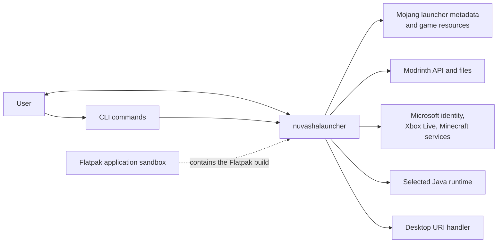
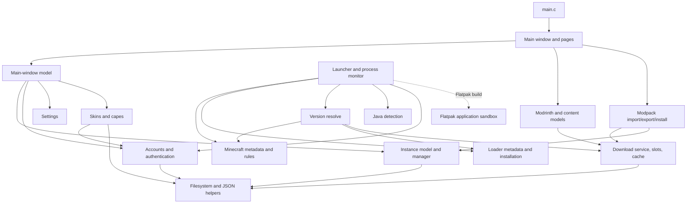
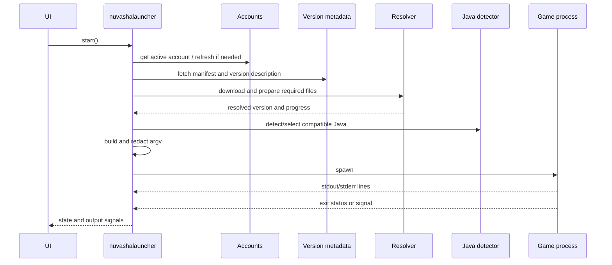

# nuvashalauncher architecture

This is a maintainer's map of nuvashalauncher. It describes the boundaries
between the parts of the program, the flows that cross those boundaries, and
the rules that are easy to break during a seemingly small change.

It is deliberately not a catalogue of every source file. The public headers
are the detailed API reference; this document explains why the pieces are
arranged as they are.

## What the program is

nuvashalauncher is a Linux GTK 4/libadwaita desktop application. It manages Minecraft
instances, obtains Minecraft and Modrinth content, chooses a Java runtime, and
starts one game process per instance. It is a single executable and does not
require a separate daemon or background service.

The application is event-driven. Network requests, subprocesses, and longer
filesystem operations expose GIO-style asynchronous APIs. Results are handed
back to the thread-default main context that started the operation, normally
the GTK main loop. UI code starts operations and reacts to signals or
callbacks; it does not own the lower-level transfer or process state.

The main process contains two kinds of state:

- **Application state:** instances, accounts, settings, active downloads, and
  launchers.
- **Content state:** Minecraft metadata, libraries, assets, natives, cached API
  responses, and files inside instance directories.

The boundary matters. An instance is a model object and knows how to validate
and serialize itself, but it does not perform network I/O or create widgets.
Likewise, the UI presents a launcher or a download entry but does not become
the owner of that operation.

## System context

External services are used directly by their owning modules:

- Mojang's version manifest and version documents are parsed by
  `nuvashalauncher-minecraft-versions.c`; resolved files are fetched by the download
  service.
- The Modrinth v2 API is handled by `nuvashalauncher-modrinth.c`.
- Microsoft device authorization, Xbox Live/XSTS, Minecraft authentication,
  entitlements, and profile requests are the steps in
  `nuvashalauncher-auth-microsoft.c`.
- `GAppInfo` opens URIs through the desktop.

## Static structure

The source is split by responsibility rather than by a framework layer. Most
modules have a public header describing the contract and, where necessary, a
private header for shared implementation state.

### Application and UI

`main.c` creates the `AdwApplication`, initializes translations, loads the
instance store and normally presents the one `nuvashalauncherMainWindow`. A second
activation focuses the existing window rather than creating another one. The
same executable also accepts a command-line instance ID and can launch that
instance through the normal launcher state machine without presenting the main
window; the window/model is still created to reuse the normal ownership and
launcher state machine, while live output remains owned by the launcher's log
buffer.

The main window owns a `nuvashalauncherMainWindowModel`. The model groups the
process-wide objects used by the UI:

- `nuvashalauncherInstanceManager`
- `nuvashalauncherDownloadService` and the `nuvashalauncherDownloads` display manager
- `nuvashalauncherSettings`
- `nuvashalauncherAccounts`
- the users popover
- launchers and instance dialogs, keyed by instance

The window is the presentation boundary. `nuvashalauncher-main-window-*.c` files
connect model signals to widgets, while page and dialog modules handle their
own views. Widgets declared in `data/ui/*.ui` and the stylesheet are compiled
into a GResource by the Makefile. The UI is therefore available from the
installed binary; it is not read from the source tree at runtime.

The downloads display is intentionally separate from the dialog that started a
download. `nuvashalauncherDownloads` is process-wide, owns entries while they run, and
lets the header show work started from any page. Closing an installer dialog
does not cancel its operation.

### Instances

`nuvashalauncherInstance` is a validated, serializable model for one Minecraft
installation. It contains a stable ID, display name, directory, Minecraft
version, loader, loader version, Java choice, JVM arguments, and component
metadata. It has no widgets, network calls, or persistence side effects.

`nuvashalauncherInstanceManager` owns the `GListStore` of instances and persists the
list to `instances.json`. It also owns operations that change the directory
layout:

- create and register an instance;
- rename or update validated properties;
- duplicate an instance;
- move an instance to another directory;
- delete an instance, with an explicit choice about deleting its files;
- open its directory with the desktop file manager.

Directory checks happen before files are touched. A new instance directory
must be absolute, must not contain `..`, and must not be the same as, inside,
or a parent of another instance directory. Moves and deletes are asynchronous
and use rollback-oriented ordering so a failed operation does not silently
remove the registered instance or its old files.

### Accounts and authentication

Accounts support two modes:

- **Offline:** a validated player name and the UUID derived from
  `OfflinePlayer:<name>`.
- **Microsoft:** a Minecraft profile, access token, expiry, refresh token, and
  cosmetic profile data.

`nuvashalauncherAccounts` owns the active account and emits changes for the UI. Account
metadata is stored in the user's data directory in `accounts.json`, written
atomically with mode `0600`. Access and refresh tokens are stored in the same
JSON file with the account metadata.

The skin menu keeps the fetched profile, skin list, and cape list in memory for
the lifetime of the launcher. Skin and cape textures are cached separately so
cape images cannot appear in the saved-skin library.

The Microsoft sign-in chain is asynchronous and explicit:

1. Request a device code.
2. Poll the Microsoft token endpoint until the user completes sign-in.
3. Exchange the Microsoft token with Xbox Live.
4. Exchange the Xbox token with XSTS.
5. Obtain a Minecraft access token.
6. Check Java entitlements.
7. Fetch the Minecraft profile and store the resulting account.

No password is handled by nuvashalauncher. A token is considered unusable slightly
before its reported expiry so a launch does not begin with a token that will
expire during startup. If refresh fails, the launcher enters
`Needs sign-in` instead of attempting to start a game with stale credentials.

### Settings

`nuvashalauncherSettings` is a typed wrapper around the installed GSettings schema in
`data/com.github.nuvashalauncher.nuvashalauncher.gschema.xml`. It validates values and
writes each accepted change. The settings include version-list filters, log
retention, language, Modrinth API caching, export behavior, dependency delete
 behavior. Window geometry is kept separately by
the window code.

## Asynchronous work and ownership

`nuvashalauncher-task.c` provides the common operation contract. There are two related
types:

- `nuvashalauncherTaskScope` owns one asynchronous operation, its cancellable, tracked
  GLib sources, callback result, and lifecycle state.
- `nuvashalauncherTaskSequence` runs a series of asynchronous steps. A step starts one
  operation and advances the sequence from its completion callback.

The scope is reference counted because the operation state and its caller may
outlive one another. A caller can cancel an operation without freeing the
state that a late callback still needs. Source IDs are tracked and removed
before task data is destroyed. Immediate results are deferred to an idle
callback where necessary, so an `_async()` function never calls its completion
callback before it returns its handle.

When adding asynchronous code:

1. Create a scope before starting work.
2. Keep all state needed by the callback in scope-owned data.
3. Check cancellation at the operation's boundaries.
4. Complete through the scope's result helpers.
5. Release the caller's scope reference according to the ownership contract.

This is the central lifetime rule of the project. A callback must not assume
that the widget that started an operation still exists.

## Downloads, caches, and content

### Transfer service

`nuvashalauncherDownloadService` owns one `SoupSession`, two waiting queues, and the
active-transfer counts. Interactive work has priority over bulk installation
work. The current limits are eight concurrent transfers overall and six bulk
transfers; the exact scheduling behavior lives in `nuvashalauncher-download-slots.c`.

File transfers follow this sequence:

1. Check for a verified destination or global hash cache hit.
2. Wait for a transfer slot.
3. Create a temporary file beside the destination.
4. Stream the response into it while calculating the expected checksum.
5. Check the HTTP result and checksum.
6. Flush/sync the file and atomically rename it into place.
7. Release the slot and complete the task.

An existing file with the expected hash is reused. A wrong checksum is retried
once; network failures, HTTP 5xx responses, and HTTP 429 responses use bounded
retries and `Retry-After` where appropriate. A 404 and other non-retryable
statuses fail directly. Cancellation or failure discards the temporary file
and never replaces a valid destination.

JSON requests use the same transfer and retry machinery. API responses can be
cached with their creation time and ETag. When enabled, an expired entry is
revalidated; if the network is unavailable, a stale response can be used as a
fallback. Cache clearing only removes the global cache tree, not installed
instance content or its indexes.

### Minecraft metadata and resolution

`nuvashalauncher-minecraft-versions.c` parses Mojang's version manifest and version
documents. It evaluates the document's OS and feature rules, resolves
`inheritsFrom` chains while detecting cycles, and supports both modern
structured arguments and legacy `minecraftArguments`.

`nuvashalauncher-minecraft-resolve.c` turns a version description into a
`nuvashalauncherResolvedVersion`:

- applicable libraries are converted to Maven paths;
- native classifiers are selected for the current Linux architecture;
- the client JAR, libraries, logging configuration, asset index, and asset
  objects are downloaded and hash-checked;
- native JARs are extracted into a separate directory;
- the final classpath and argument arrays are assembled in document order.

Resolved Minecraft data is kept below the user's data/cache locations rather
than inside the instance directory. The instance directory receives the game
files and logs; shared client artifacts can be reused by multiple instances.

Network-provided archive entries are not trusted. Native extraction rejects
unsafe paths and skips links. The resolver only writes regular files and real
directories below the intended destination.

### Mod loaders

`nuvashalauncher-loaders.c` supports Vanilla, Fabric, Quilt, Forge, and NeoForge, but
the installation paths are not identical:

- Fabric and Quilt publish version lists and profile documents. Their profiles
  are merged over the Minecraft version document and their Maven coordinates
  are converted into the same resolved-file inputs used by vanilla versions.
- Forge and NeoForge publish installer JARs. nuvashalauncher downloads the installer,
  reads its install profile, runs the client-side processors with Java, and
  stores the resulting loader installation under the shared data directory.

Loader installations are separate from instance directories. The launcher
uses the resulting client JAR and merged version document when resolving and
launching an instance. A failed or unsupported installer stops before a game
is started; it does not register a partially prepared loader as usable.

### Modrinth content

`nuvashalauncher-modrinth.c` is deliberately Modrinth-specific. It builds API facets,
parses search/project/version answers, and filters compatibility before data
reaches the UI:

- mods must match the instance's Minecraft version and loader;
- resource packs and shader packs must match the Minecraft version;
- incompatible versions are not merely hidden at install time—they are not
  offered as compatible results.

Content pages use models and rows, not raw API JSON. Details are converted from
Modrinth Markdown to the restricted GTK markup the UI expects. Installed
content pages share an edit/selection model: checkboxes can select files for
bulk deletion, the action footer appears only when something is selected, and
the existing dependency-delete policy is applied by the same deletion pipeline
as a single-file delete. Update All uses that page's asynchronous operation
state and exposes its scan/install progress and cancellation through a
downloads-style popover.

`nuvashalauncher-content-index.c` maintains local metadata for installed content. The
index records hashes, filenames, provider/project identity, versions,
environment flags, and required/optional/incompatible dependencies. It lets
the UI identify and update installed content without treating the directory
listing as the source of truth.

### Modpacks

An `.mrpack` contains a root `modrinth.index.json`, downloaded files described
by that index, and an overrides tree. The modpack module:

- validates the format and supported game;
- resolves the Minecraft version and loader from dependencies;
- checks every path before writing it;
- accepts downloads only from hosts permitted by the format;
- verifies file hashes;
- rejects links and unsafe archive entries;
- caps archive entries and inflated content to limit decompression bombs;
- installs into a fresh directory before registering the instance.

Optional files are selected by the user. Required files are installed first;
dependency deletion behavior is controlled by settings. An installation that
cannot finish should leave the existing instance and metadata intact.

## Launch pipeline

`nuvashalauncher` belongs to one instance and is the owner of that instance's
launch state, log buffer, preparation scope, and child process. A launcher
refuses a second start while its state is busy.

The public state sequence is:

`Preparing` → `Downloading` → `Launching` → `Running` → `Stopping` →
`Stopped` or `Crashed`.

Failures before process start use `Failed`. An account that needs a new
login uses `Needs sign-in`; that state is not busy, because no game process is
running and the user may retry after signing in.

The command-line builder is kept testable without a JVM or network. It merges
version arguments, instance JVM arguments, paths from the resolver, account
placeholders, the main class, and game arguments into an argv array. The
redacted form is the only form used in logs. Access tokens and values after
the relevant password/token options are replaced before output is recorded.

Java detection probes candidates asynchronously and parses `java -version` and
related properties, including whether the runtime has AWT's X11 bridge. It
prefers a window-capable compatible runtime and chooses the instance's
explicit Java when one is configured. Launch preparation rejects a selected
headless runtime; it does not silently downgrade to a different major version.

Stopping sends `SIGTERM` first and escalates after five seconds. Process output
is consumed by the line-reader helper, capped per line, and retained only up to
the configured log-line limit. Crash reports are associated with the process start time so an
old report is not mistaken for a crash from the current launch.

## Flatpak boundary

Flatpak is a packaging and runtime variant, not a second launcher
implementation. The manifest builds the same source with `FLATPAK=1`. Java
runtimes selected by the user can be probed even when they are not in the
runtime's normal host search paths.

The application manifest grants network access, Wayland and fallback X11,
audio, and device access required by the graphics stack. It does not grant
`filesystem=home`. Flatpak therefore remains the outer process boundary for
the launcher and the game, while the application uses its normal GLib data and
cache directories inside the per-application data area.

Flatpak does not bundle a JRE. A custom runtime is added through the Java
picker as a runtime directory containing `bin/java`; the executable is probed
before it is accepted. The selected paths are registered in the shared
`custom-java-paths` setting and are available to all instance pages in that
Flatpak installation. An instance still stores its own selected Java path.

## Persistence and filesystem layout

The exact base directories follow GLib's user-data and user-cache locations.
The important files are:

| Data | Location/purpose |
| --- | --- |
| Instance registry | `<user data>/nuvashalauncher/instances.json` |
| Instance content | Registered instance directories, each with game files and logs |
| Account metadata | `<user data>/nuvashalauncher/accounts.json` |
| Account tokens | `<user data>/nuvashalauncher/accounts.json`, mode `0600` |
| Shared resolved content | `<user data>/nuvashalauncher/` shared client artifacts and assets |
| Saved skins and cape textures | `<user data>/nuvashalauncher/skins/` |
| Version metadata | `<user cache>/nuvashalauncher/versions/` |
| API responses | `<user cache>/nuvashalauncher/` API cache tree |
| GSettings | Installed schema and the user's GSettings backend |

Writes that represent a complete document use temporary files and replacement
where the module contract promises atomicity. Do not add a direct
`g_file_set_contents()` write to an existing registry, account file, or cache
format without preserving the module's failure behavior.

## Security properties

The security-sensitive code is distributed across the file, archive, account,
and process boundaries:

- Downloaded files are hash-checked when the source publishes a hash and are
  never installed directly over an existing destination.
- Instance and archive paths reject traversal, absolute paths, backslashes,
  links, and overlapping instance directories where those checks apply.
- ZIP entry counts and inflated size are bounded.
- Modpack download URLs are restricted to hosts allowed by the format.
- Account metadata and tokens are stored in `accounts.json` with mode `0600`.
  This is intentional: the launcher must read the tokens to authenticate the
  Minecraft process, so a separate secret store would not remove the
  launcher's access to them. Tokens never enter logs, error messages, or
  redacted command output; Minecraft still receives the access token through
  the launch arguments it requires.
- UI text that can contain paths or service errors is treated as plain text,
  not markup.

These are architectural properties, not optional cleanup. A new importer,
content provider, or launcher argument path must preserve them at its own
boundary.

## Build and test shape

The repository uses a hand-written `Makefile`:

- `make` builds the release binary, compiled resources, schemas, and locales.
- `make fast` builds the release target in parallel.
- `make debug` builds a separate AddressSanitizer/UndefinedBehaviorSanitizer
  binary under `build-debug/`.
- `make test` builds and runs each `tests/test-*.c` binary.
- `make test-display` repeats the suite under an existing Wayland session,
  and skips itself when there is no compositor.
- `make test-flatpak-runtime` smoke-tests an installed Flatpak's CLI, sandbox
  data directory, host-data isolation, and network permission without starting
  Minecraft.
- `make test-debug` and `make test-lsan` exercise the sanitizer build.
- `make static-analysis` runs GCC's analyzer over source files.
- `flatpak-builder` builds the manifest in
  `packaging/flatpak/com.github.nuvashalauncher.nuvashalauncher.yml` with the GNOME 51
  runtime.

Tests are intentionally layered. Parsers, path rules, argument builders,
security checks, and state machines can run without a display, network, JVM,
or live account. Download and Modrinth tests use local fixtures/servers. UI
tests instantiate the compiled resource templates, and display-sensitive tests
skip or use a virtual display when the environment does not provide one.

CI builds both x86_64 and ARM64 Fedora containers, treats compiler warnings as
errors for the release build, runs the test suite, and runs static analysis.

## Adding or changing a subsystem

Use the existing boundary that owns the behavior:

- Add a persisted instance field to `nuvashalauncherInstance`, its JSON conversion,
  validation, manager update path, and relevant tests together.
- Add a preference to the GSettings schema, then expose validated accessors in
  `nuvashalauncherSettings` and bind it in the settings UI.
- Add a network operation through the download service rather than creating a
  second `SoupSession` or an ad-hoc retry loop.
- Keep response parsing in a plain data function with fixture-based tests;
  keep the live async request as a thin wrapper around it.
- Add a launch preparation step without putting blocking work in the UI or
  bypassing the launcher's state machine.
- Keep long-lived operations owned by their manager or launcher, not by the
  dialog that happened to start them.

When a change alters one of the decisions above, update this document and add
an ADR if the change affects security, persistence, external interfaces,
dependency choice, or a quality property such as cancellability or atomicity.

## Decisions worth preserving

These are the choices most likely to be misunderstood later:

1. **One process, shared main-context asynchronous APIs.** This keeps GTK
   ownership predictable while allowing network, filesystem, and child-process
   work to make progress without blocking the UI.
2. **A reusable download service instead of per-feature HTTP code.** It gives
   every caller the same slot scheduling, retry, cancellation, hashing, and
   temporary-file behavior.
3. **Plain parsers beside asynchronous wrappers.** Tests can cover protocol and
   security rules with fixtures, while live code remains responsible for
   transport and lifetime management.
4. **Install into safe temporary/fresh locations before registration.** A
   failed import or move must not leave metadata pointing at an incomplete
   installation.
5. **No provider abstraction for Modrinth yet.** Modrinth is the product's
   current content source. An abstraction should be introduced only when a
   second provider creates a real need, not as empty indirection.

## Keeping this document useful

Update this file when a change affects module ownership, a persisted format,
an external protocol, a process boundary, a security invariant, or the build
and test contract. Do not update it for a renamed local helper or an ordinary
UI rearrangement. If a detail belongs to one function's ownership rules, put
it in that function's header comment instead.
